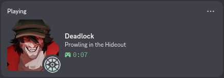

<div align="center">
  

  # RubyLock RPC

  Zero-dependency Ruby Discord Rich Presence client for **Deadlock**. Automatically shows your hero, match mode, elapsed match timer, and game phase on your Discord profile on **Windows (`.exe` installer)** and **Linux**, licensed under **GPL-3.0**.

  <p>
    <a href="https://github.com/buntatoes/rubylock-rpc/releases/latest"></a>
    <a href="https://github.com/buntatoes/rubylock-rpc/releases"></a>
    <a href="https://github.com/buntatoes/rubylock-rpc/actions/workflows/ci.yml"></a>
    <a href="#installation--packaging"></a>
    <a href="#installation--packaging"></a>
    <a href="LICENSE"></a>
  </p>

</div>

## Preview

<div align="center">
  
</div>

## Features

- **100% Pure Ruby Core (Zero External Gems)**: Runs on standard Ruby (`3.2+` / `3.4+`) using only the Ruby standard library (`json`, `net/http`, `socket`, `fiddle`, `win32/registry`, `zlib`).
- **Persistent System Tray Icon (Windows & Linux GNOME / KDE)**: Stays accessible in your system tray while active via native Win32 `Shell_NotifyIconW` on Windows and native D-Bus `StatusNotifierItem` + `DBusMenu` on Linux (KDE Plasma, GNOME with AppIndicator, COSMIC, XFCE). Click the tray icon to see live status, launch Deadlock, toggle **Exit When Game Closes** or **Auto-Update**, open your config folder, check for updates, or quit cleanly.
- **GitHub Release Auto-Updater**: Automatically checks GitHub Releases on startup and prompts to install new versions (or silently downloads and installs updates when `auto_update = true` in `config.toml` or via `rubylock-rpc --update`).
- **Windows `.exe` Installer with Desktop Shortcut**: `RubyLock-RPC-Setup-v1.3.0-win64.exe` installs `rubylock-rpc.exe` and the Ruby runtime files to `%LOCALAPPDATA%\RubyLock-RPC`, registers Windows Add/Remove Programs uninstall support, and creates **"RubyLock RPC"** shortcuts on your Desktop and Start Menu so double-clicking launches Deadlock with `-condebug` and Discord Rich Presence.
- **Linux GUI Installer & Uninstaller**: `rubylock-rpc-linux-x86_64.tar.gz` includes a native ELF wrapper, graphical setup/uninstall dialogs (`zenity` / `kdialog` with terminal & `--silent` fallbacks), XDG desktop entry with right-click **Uninstall** action, and app icon installation for `~/.local`.
- **Live Discord Rich Presence**: Displays your current hero, match mode (`Standard Match`, `Ranked Match`, `Street Brawl`, `Bot Match`, `Training Range`, `Hero Labs`), match elapsed timer, party headcount in the Hideout, and game phase.
- **Five Hero Portrait Styles**: Supports `"normal"`, `"gloat"`, `"critical"`, `"icon"`, and `"fullbody"` portraits via the community [Deadlock API](https://deadlock-api.com), with an offline hero fallback table.
- **VAC-Safe Log Tailing**: Reads Deadlock's `-condebug` console log (`game/citadel/console.log`) and never reads game memory, modifies game files, or intercepts network traffic.
- **Cross-Platform Discord IPC**: Connects automatically to each user's local Discord client via Windows Named Pipes (`\\.\pipe\discord-ipc-0..9`) or Linux UNIX Domain Sockets (native, Flatpak, Snap, and Vesktop) — no personal Discord IDs are ever stored. Optionally supports a custom `discord_app_id` override in `config.toml`.

## Installation & Packaging

Requires [Ruby 3.2+](https://www.ruby-lang.org/) (tested on Ruby 3.4).

### Windows (`.exe` Installer)

1. Download `RubyLock-RPC-Setup-v1.3.0-win64.exe` from the [Releases](../../releases) page (or build it from source with `ruby scripts/package.rb --exe`).
2. Run `RubyLock-RPC-Setup-v1.3.0-win64.exe` to install to `%LOCALAPPDATA%\RubyLock-RPC` and create the **"RubyLock RPC"** Desktop shortcut.
3. Double-click the **"RubyLock RPC"** shortcut on your Desktop to launch Deadlock with Discord Rich Presence automatically.
4. To uninstall later, use Windows **Installed Apps / Add or Remove Programs** (or run `rubylock-rpc --uninstall`).

> [!NOTE]
> Windows may show a **"Windows protected your PC"** warning. This happens because the app is not signed, not because it is harmful. Click **More info**, then **Run anyway**. If you'd rather verify the code yourself, [build from source](#building-packages-from-source).

### Linux (`.tar.gz` / GUI & CLI Installer)

1. Download `rubylock-rpc-linux-x86_64.tar.gz` from the [Releases](../../releases) page (or build it from source with `ruby scripts/package.rb --linux`).
2. Extract and run `./install.sh` (automatically shows a native GUI installer/updater/uninstaller on GNOME/KDE via `zenity` or `kdialog`, or use `./install.sh --silent` for headless installs):

```bash
tar -xzf rubylock-rpc-linux-x86_64.tar.gz
cd rubylock-rpc-linux-x86_64
./install.sh
rubylock-rpc
```

3. To uninstall later, run `rubylock-rpc --uninstall`, right-click **RubyLock RPC** in your application menu → **Uninstall RubyLock RPC**, or run `./uninstall.sh`.

> [!TIP]
> On **GNOME**, install the **AppIndicator and KStatusNotifierItem Support** extension (included by default on Ubuntu and Pop!_OS) so the persistent system tray icon appears in the top bar. **KDE Plasma** supports the tray icon out of the box.

### Building Packages from Source

```bash
git clone https://github.com/buntatoes/rubylock-rpc.git
cd rubylock-rpc

# Build both dist/RubyLock-RPC-Setup-v1.3.0-win64.exe and dist/rubylock-rpc-linux-x86_64.tar.gz:
ruby scripts/package.rb
```

## Launching Deadlock

Rich Presence reads Deadlock's console log file (`game/citadel/console.log`), which requires the `-condebug` launch option:

1. **Use the Desktop / App Shortcut**: Launch **RubyLock RPC** from your Desktop or application menu. It starts Discord Rich Presence in the system tray and launches Deadlock via Steam with `-condebug`.
2. **Use Steam Launch Options**: In Steam, right-click **Deadlock -> Properties -> Launch Options** and set:
   ```sh
   rubylock-rpc --launch-with-command -- %command%
   ```
3. **Launch both manually**: Add `-condebug` to Deadlock's Steam Launch Options and run `rubylock-rpc --no-launch`.

## CLI Flags

| Flag | Description |
|------|-------------|
| `--no-launch` | Skip launching Deadlock on startup, even if `launch_game_on_start` is enabled in `config.toml`. |
| `--no-tray` | Run without a system tray icon. |
| `--no-update-check` | Skip the background GitHub release update check on startup. |
| `--check-update` | Check GitHub Releases for a newer version and exit. |
| `--update` | Download and install the latest GitHub release immediately. |
| `--uninstall` | Launch the GUI uninstaller (combine with `--silent` for headless uninstall). |
| `--silent` | Run `--update` or `--uninstall` non-interactively. |
| `--no-shortcut` | Skip shortcut prompt handling. |
| `--launch-with-command -- <command>` | Launch the game by running `<command>` with `-condebug` appended (for Steam `%command%`). |
| `--generate-config` | Write a fresh `config.toml` with all default settings and exit. |
| `-v`, `--version` | Print version and exit. |
| `-h`, `--help` | Show CLI usage help. |

## Running Tests

```bash
ruby -Ilib:test test/test_rubylock_rpc.rb
```

## License & Attribution

- **Author**: [Buntato](https://github.com/buntatoes)
- **License**: **GNU General Public License v3.0 ([GPL-3.0](LICENSE))**
- **Upstream Notice**: RubyLock RPC is a Ruby reimplementation based on the original GPL-3.0 Rust project [HeyTariq/deadlock-rpc](https://github.com/HeyTariq/deadlock-rpc).

## Disclaimer

Not affiliated with, endorsed by, or connected to Valve Corporation. **Deadlock**, all hero names, images, and related assets are the property of **Valve Corporation**. Hero images displayed in Discord are sourced from the community-maintained [Deadlock API](https://deadlock-api.com) and remain the property of Valve. This project does not distribute or claim ownership of any Valve assets.
